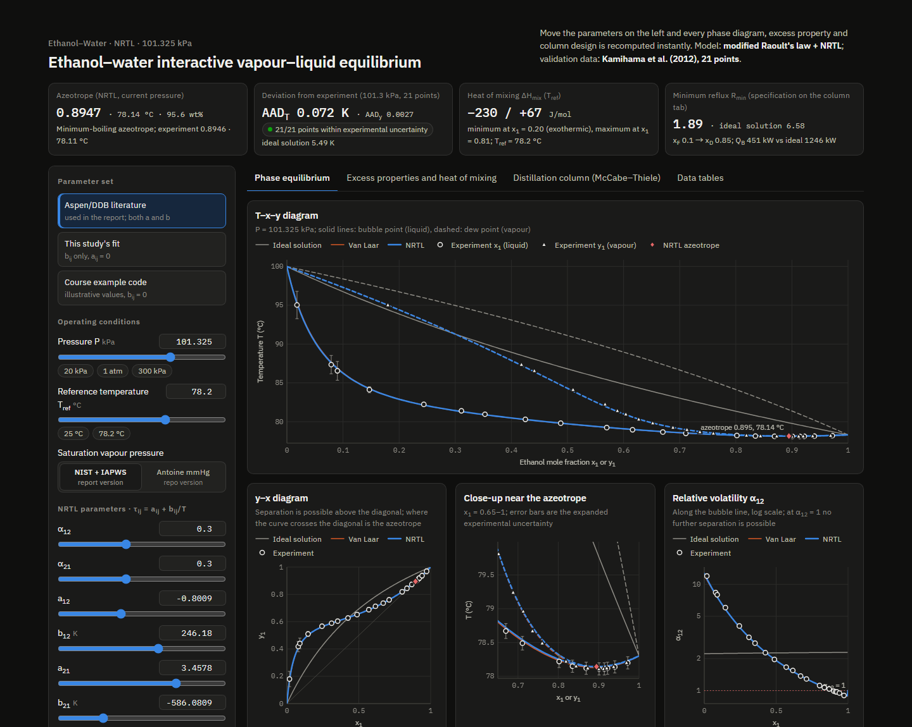

# Ethanol-Water-VLE

[](https://github.com/Shuruyue/Ethanol-Water-VLE/actions/workflows/ci.yml)


**[Interactive page](https://shuruyue.github.io/Ethanol-Water-VLE/web/ethanol-water-vle.html)**: move the sliders to recompute T–x–y, the deviation from the Kamihama et al. (2012) data, ΔH_mix and the McCabe–Thiele column live in the browser (one self-contained file; also works offline). The ideal-solution model misses the boiling points of ethanol–water at 1 atm by up to 11 K and cannot produce the azeotrope; NRTL with literature parameters matches the 21 measured points to 0.07 K on average and puts the azeotrope at x₁ = 0.895 and 78.14 °C (measured: 0.895 and 78.11 °C).

[](https://shuruyue.github.io/Ethanol-Water-VLE/web/ethanol-water-vle.html)

## Ethanol–Water VLE with NRTL

Final project of a chemical thermodynamics course (Sandler, *Chemical, Biochemical, and Engineering Thermodynamics*): vapour–liquid equilibrium of ethanol(1)–water(2) at 1 atm with an activity-coefficient model, the excess properties, and what the non-ideality means for the energy demand and design of a distillation column. The models are validated against the isobaric data of Kamihama et al. (2012).

> This project originally lived in the `vle_consulting/` folder of a fork of
> [CalebBell/thermo](https://github.com/CalebBell/thermo) (the fork has since been removed).
> It was split out with its full commit history; the code does not depend on that fork.

### Two code bases

| Folder | What it is | Vapour pressure |
|---|---|---|
| [`report2026/`](report2026/) | **The current analysis.** The revised report (PDF) and the calculations behind every number in it: parameter regression, validation, Herington consistency test, excess properties, azeotrope vs pressure, pressure-swing and column design, ethylene glycol ternary data. The results on this page come from here. | ethanol: NIST Antoine set (Ambrose & Sprake 1970); water: IAPWS-95 |
| [`src/`](src/) | The original course-project code: command-line analysis, Streamlit dashboard, figure and CSV export to `final_outputs/`. | tabulated mmHg / °C Antoine sets ([`data/parameter_db.json`](data/parameter_db.json)) |

Both use the same literature NRTL parameters. The vapour-pressure correlations shift the results slightly: the mean temperature error against the data is 0.072 K in `report2026/` and 0.088 K in `src/`, and the azeotrope is at x₁ = 0.895, 78.14 °C and x₁ = 0.897, 78.17 °C. The interactive page can switch between the two.

## Key Results

At 101.3 kPa, against the 21 points of Kamihama et al. (2012) (`report2026/`):

| Model | Mean \|ΔT\| | Max \|ΔT\| | Mean \|Δy₁\| | Azeotrope |
|---|---|---|---|---|
| Ideal solution (Raoult's law) | 5.5 K | 11.2 K | 0.092 | none |
| NRTL, literature parameters (Aspen / DDB) | 0.072 K | 0.28 K | 0.0027 | x₁ = 0.895, 78.14 °C |
| NRTL, fitted to the data here | 0.116 K | 0.61 K | 0.0039 | x₁ = 0.891, 78.13 °C |
| Van Laar, fitted to the data here | 0.080 K | 0.35 K | 0.0031 | x₁ = 0.892, 78.13 °C |
| Measured | | | | x₁ = 0.895, 78.11 °C |

- The data pass the Herington consistency test (D = 3.7 < J = 9.3).
- Vapour-phase non-ideality (Tsonopoulos second virial coefficients) moves the bubble temperature by at most 0.06 K at 1 atm, so the ideal-gas vapour is adequate there.
- Column design, 100 kmol/h from x_F = 0.10 to x_D = 0.85 at R = 1.3 R_min: the ideal-solution model gives R_min = 6.6 and a reboiler duty of 1250 kW, NRTL gives R_min = 1.9 and 451 kW. The ideal model overestimates the energy demand 2.8-fold, and a column designed with it reaches only x_D = 0.83 in the real system.
- |ΔH_mix| stays below 0.6 % of the heat of vaporization, so mixing heat does not matter for the column energy balance.

## Quick Start

```bash
git clone https://github.com/Shuruyue/Ethanol-Water-VLE.git
cd Ethanol-Water-VLE
pip install -r requirements.txt pytest pandas chemicals CoolProp
```

### Report calculations (`report2026/`)

```bash
cd report2026/calc
python run_analysis.py && python make_figures.py   # results/ and fig/
python make_numbers.py && python make_tables.py    # LaTeX number macros and tables
```

Every number in the PDF is read from `results/results.json`. Building the PDF needs XeLaTeX with Chinese support; see [`report2026/README.md`](report2026/README.md).

### Course code (`src/`)

```bash
python src/main.py                         # summary and T-x-y, y-x, GE, HE, McCabe-Thiele plots → figures/
python src/final_build.py --output-root final_outputs --points 80 --t-ref 78.2
streamlit run src/interactive_app.py       # dashboard: pressure, temperature, NRTL parameters
```

`final_build.py` writes the committed [`final_outputs/`](final_outputs/): baseline and practical-pack plots, model curves, isothermal G^E/H^E/C_p^E/γ/α₁₂ tables at 78.2 °C, the azeotrope-vs-pressure sweep and `run_summary.json`.

## Validation

```bash
pytest -q tests                                  # 47 tests of src/, including validation against the measured data
python tests/verify_scientific_correctness.py    # 22 scientific checks (optional cross-check with `pip install thermo`)
cd report2026/calc && pytest -q test_core.py     # 13 tests: Gibbs–Helmholtz, pure-component limits, azeotrope vs experiment
```

CI runs all three on Ubuntu and Windows with Python 3.10 and 3.12.

## Limitations

- Binary system only, with constant-molar-overflow McCabe–Thiele columns (saturated-liquid feed, total condenser; no tray efficiency or hydraulics).
- The literature NRTL parameters come without uncertainties; standard errors are given only for the parameters fitted here.
- The `src/` Antoine set for ethanol is tabulated up to 80 °C and is extrapolated at the water-rich end of the 1 atm diagram (deviation from the Schroeder et al. 2014 reference equation of state below 0.8 % up to 100 °C).
- `src/` treats the vapour as an ideal gas. `report2026/` checks the second-virial correction, which is small at 1 atm but grows with pressure (the pressure-swing case goes up to 300 kPa).

## Project Structure

```text
Ethanol-Water-VLE/
├── report2026/                 # current analysis and report
│   ├── calc/                   # vle_core.py, run_analysis.py, figure/number/table scripts, test_core.py
│   ├── data/                   # Kamihama et al. (2012): binary and ternary data with ethylene glycol
│   ├── results/                # results.json and CSV tables (generated)
│   ├── fig/  tex/              # figures and LaTeX source
│   └── VLE_Consulting_Report_2026.pdf
├── src/                        # original course code
│   ├── models.py  solver.py    # Antoine, ideal / Van Laar / NRTL, bubble-point solver
│   ├── pipeline.py  analysis.py  profiles.py  experimental_data.py  parameter_store.py
│   ├── main.py  final_build.py  output_pack.py  export_data.py  plotting.py
│   └── interactive_app.py      # Streamlit dashboard
├── data/
│   ├── parameter_db.json       # parameters with sources (used by src/)
│   └── experimental/           # Kamihama et al. (2012) ethanol–water at 101.3 kPa
├── final_outputs/              # plots and tables written by src/final_build.py
├── tests/                      # pytest suite for src/ and verify_scientific_correctness.py
├── web/                        # interactive page (GitHub Pages)
└── .github/workflows/ci.yml
```

## Data and Parameter Sources

- **NRTL**: Aspen Plus databank values regressed from the Dortmund Data Bank (a₁₂ = −0.8009, b₁₂ = 246.18 K, a₂₁ = 3.4578, b₂₁ = −586.08 K, α = 0.3), as tabulated in Beneke et al. (2013), Appendix B. τᵢⱼ = aᵢⱼ + bᵢⱼ/T.
- **Vapour pressure**: `report2026/` uses the NIST WebBook Antoine set for ethanol (Ambrose & Sprake 1970, 292.77–366.63 K) and IAPWS-95 for water. `src/` uses common tabulated mmHg / °C Antoine sets (ethanol −57 to 80 °C, water −20 to 100 °C); these are not NIST sets.
- **Van Laar**: A₁₂ = 1.65, A₂₁ = 0.95 in `src/` are the illustrative values of the course handout code, not literature values; `report2026/` fits A₁₂ = 1.700 ± 0.013, A₂₁ = 0.953 ± 0.002.
- **Experimental data**: Kamihama et al. (2012), transcribed from the NIST TRC ThermoML archive with the TRC expanded uncertainties.
- `data/parameter_db.json` stores every parameter block with its source; the loader rejects blocks without one.

## References

1. H. Renon, J. M. Prausnitz, Local compositions in thermodynamic excess functions for liquid mixtures, *AIChE J.* **14** (1968) 135–144.
2. N. Kamihama, H. Matsuda, K. Kurihara, K. Tochigi, S. Oba, Isobaric vapor–liquid equilibria for ethanol + water + ethylene glycol and its constituent three binary systems, *J. Chem. Eng. Data* **57** (2012) 339–344. [doi:10.1021/je2008704](https://doi.org/10.1021/je2008704)
3. D. Beneke, M. Peters, D. Glasser, D. Hildebrandt, *Understanding Distillation Using Column Profile Maps*, Wiley, 2013, Appendix B.
4. D. Ambrose, C. H. S. Sprake, Thermodynamic properties of organic oxygen compounds XXV, *J. Chem. Thermodyn.* **2** (1970) 631–645.
5. W. Wagner, A. Pruß, The IAPWS formulation 1995 for the thermodynamic properties of ordinary water substance, *J. Phys. Chem. Ref. Data* **31** (2002) 387–535.
6. C. Tsonopoulos, An empirical correlation of second virial coefficients, *AIChE J.* **20** (1974) 263–272.
7. E. F. G. Herington, Tests for the consistency of experimental isobaric vapour–liquid equilibrium data, *J. Inst. Petrol.* **37** (1951) 457–470.
8. S. I. Sandler, *Chemical, Biochemical, and Engineering Thermodynamics*, 5th ed., Wiley, 2017.

## License

MIT License.
